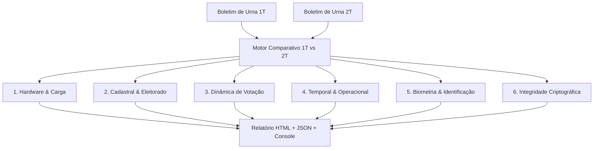

# Ferramenta Forense de Auditoria da Urna Eletrônica (TSE)

[](https://www.python.org/)
[](tests/)
[](#1-princípios-de-segurança-e-custódia-forense)
[-purple.svg)](#5-auditoria-comparativa-de-inconsistências-1º-vs-2º-turno)
[](#6-relatórios-gerados-e-visualizadores-interativos)
[](LICENSE)

Ferramenta forense modular e de alta performance para auditoria técnica, decodificação ASN.1, conferência criptográfica e análise comparativa de integridade dos arquivos oficiais gerados pelas urnas eletrônicas brasileiras do Tribunal Superior Eleitoral (TSE).

Desenvolvida com rigor científico e neutralidade matemática, seguindo estritamente as especificações oficiais do TSE, as normas de **cadeia de custódia de evidências digitais (ISO/IEC 27037)** e a preservação irrevogável do **sigilo constitucional do voto**.

---

## Sumário

1. [Princípios de Segurança e Custódia Forense](#1-princípios-de-segurança-e-custódia-forense)
2. [Arquivos Oficiais Auditados](#2-arquivos-oficiais-auditados)
3. [Requisitos e Instalação](#3-requisitos-e-instalação)
4. [Como Usar (Linha de Comando)](#4-como-usar-linha-de-comando)
   - [4.1 Auditoria Completa de uma Urna Específica](#41-auditoria-completa-de-uma-urna-específica)
   - [4.2 Modo Rápido (`--fast`) para Urna Alvo em < 1 segundo](#42-modo-rápido---fast-para-urna-alvo-em--1-segundo)
   - [4.3 Listagem e Inventário de Seções na Pasta](#43-listagem-e-inventário-de-seções-na-pasta)
   - [4.4 Totalização e Auditoria Estadual Consolidada (`--all`)](#44-totalização-e-auditoria-estadual-consolidada---all)
5. [Auditoria Comparativa de Inconsistências: 1º vs 2º Turno](#5-auditoria-comparativa-de-inconsistências-1º-vs-2º-turno)
   - [5.1 Execução da Comparação](#51-execução-da-comparação)
   - [5.2 Catálogo dos 24+ Detectores de Inconsistências](#52-catálogo-dos-24-detectores-de-inconsistências)
   - [5.3 Exemplo Real de Execução (17.326 seções de SC)](#53-exemplo-real-de-execução-17326-seções-de-sc)
6. [Relatórios Gerados e Visualizadores Interativos](#6-relatórios-gerados-e-visualizadores-interativos)
7. [Vocabulário Controlado de Auditoria](#7-vocabulário-controlado-de-auditoria)
8. [Testes Automatizados](#8-testes-automatizados)

---

## 1. Princípios de Segurança e Custódia Forense

- **Modo Estritamente Somente Leitura:** Os arquivos de evidência nunca são abertos com permissão de escrita e jamais sofrem qualquer modificação.
- **Análise Não Destrutiva:** Nenhuma descompactação ou escrita temporária ocorre dentro do diretório de entrada. Todas as saídas são gravadas em pasta isolada de análise (`analysis/`, `comparison_analysis/`, etc.).
- **Conferência Pré e Pós-Execução (Integridade Provada):**
  1. Todos os arquivos são inventariados e recebem hashes **SHA-256** e **SHA-512** gravados em `manifest.json`.
  2. Ao final da análise, os hashes dos arquivos originais são recalculados para provar matematicamente que nenhum byte da evidência foi violado durante a auditoria (`post_run_verification.ok = true`).
- **Preservação do Sigilo do Voto:** O Registro Digital do Voto (RDV) é processado exclusivamente para conferência quantitativa e integridade de apuração cruzada com o Boletim de Urna (BU). A ferramenta **não** exporta nem correlaciona votantes individuais.
- **Neutralidade Científica:** Os detectores aplicam regras técnicas e lógicas objetivas. Não são feitas suposições inferenciais sem embasamento matemático ou documental.

---

## 2. Arquivos Oficiais Auditados

A ferramenta processa o conjunto oficial de arquivos distribuídos pelo TSE, identificados pela nomenclatura padrão `o<pleito_5d><uf_2><municipio_5d><zona_4d><secao_4d>-<tipo>.<ext>`:

| Arquivo | Formato / Estrutura | Função no Processo de Auditoria |
|---|---|---|
| `-bu.dat` | **ASN.1 DER v2** (`EntidadeEnvelopeGenerico` + `EntidadeBoletimUrna`) | Boletim de Urna digital com totalização por cargo, eleitores aptos, comparecimento, abstenção, detalhamento de biometria e cadeia de hashes SHA-512. |
| `-rdv.dat` | **ASN.1 BER** (`EntidadeResultadoRDV`) | Registro Digital do Voto tabulado para confronto estatístico e aritmético exato de votos apurados. |
| `-log.jez` | **Container ZIP Deflate** com `logd.dat` | Log operacional da urna (TSV em Latin-1 com data/hora, severidade, módulo, ID da urna, mensagem e código MAC de 64 bits). |
| `-vota.vsc` | **Envelope Criptográfico** ASN.1 | Assinatura digital de software (CEPESC), hardware (Ed521/ECDSA), hashes SHA-512 de cada arquivo e certificados X.509 da urna. |
| `-imgbu.dat` | **Spool de Impressão Térmica** (ESC/P Latin-1) | Espelho binário/textual exato do Boletim de Urna físico impresso na seção às 17h, lido sem dependência de OCR. |

---

## 3. Requisitos e Instalação

### Requisitos de Sistema
- **Python 3.11 ou 3.12+**
- Sistemas Operacionais suportados: **Windows 10/11**, **Linux (Ubuntu/Debian/RHEL)** ou **macOS**
- Espaço em disco suficiente para os dados oficiais (opcionalmente 80.000+ arquivos por estado)

### Instalação

```bash
# Clone o repositório
git clone https://github.com/dilneiss/urna-forense.git
cd urna-forense

# Crie e ative um ambiente virtual
python -m venv .venv
# No Linux/macOS:
source .venv/bin/activate
# No Windows:
.venv\Scripts\activate

# Instale as dependências
pip install -r requirements.txt
```

O arquivo `requirements.txt` requer bibliotecas padrão seguras e auditáveis:
```text
cryptography>=42.0.0
pytest>=8.0.0
```

---

## 4. Como Usar (Linha de Comando)

### 4.1 Auditoria Completa de uma Urna Específica

Para auditar individualmente uma urna com reconstrução de timeline, conferência cruzada e integridade criptográfica:

```bash
# Análise padrão indicando UF, Município (código ou nome), Zona e Seção:
python analyzer.py \
  --input "C:/dados/bu_imgbu_logjez_rdv_vscmr_2026_1t_SC" \
  --output "analysis_secao" \
  --uf SC \
  --municipio 80535 \
  --zona 44 \
  --secao 144 \
  --turno 1 \
  --data-eleicao 2026-10-04 \
  --municipios-csv data/municipio_tse_ibge.csv
```

A ferramenta reconstitui automaticamente a linha do tempo precisa:
```text
07:19:52 │ Inicialização da Urna (energização registrada no boot)
07:20:29 │ Início das operações do logd
07:21:00 │ Identificação da Seção (Município 80535, Zona 0044, Seção 0144, Local 1236)
08:00:01 │ ABERTURA DA VOTAÇÃO ("Urna pronta para receber votos")
08:04:35 │ Primeiro voto computado do dia
  ...    │ 324 votos computados (intervalo mín 45s, med 84s, máx 461s)
16:56:28 │ Último voto computado do dia
17:00:48 │ Mesário seleciona "Encerrar votação"
17:01:17 │ ENCERRAMENTO DA VOTAÇÃO ("Procedimento de encerramento confirmado")
17:03:07 │ Geração do Relatório do BU (dataHoraEmissao)
17:03:09 │ Início da impressão física do Boletim de Urna
17:04:06 │ Gravação dos arquivos de resultado (bu.dat, rdv.dat, imgbu.dat)
17:04:11 │ Início do empacotamento do log (log.jez)
17:04:21 │ Assinatura digital dos arquivos pela urna (vota.vsc)
```

### 4.2 Modo Rápido (`--fast`) para Urna Alvo em < 1 segundo

Quando a pasta contém dezenas de milhares de arquivos (ex.: UF completa com 86.000 arquivos), o modo `--fast` localiza instantaneamente apenas os arquivos da urna alvo pelo padrão de nome:

```bash
python analyzer.py \
  --input "C:/dados/bu_imgbu_logjez_rdv_vscmr_2026_1t_SC" \
  --output "analysis_rapida" \
  --uf SC --municipio 80535 --zona 44 --secao 144 \
  --fast
```

### 4.3 Listagem e Inventário de Seções na Pasta

Para inspecionar o conteúdo de um diretório sem executar o processamento completo:

```bash
python analyzer.py --input "C:/dados/pasta_eleicoes" --list --limit 30
```

### 4.4 Totalização e Auditoria Estadual Consolidada (`--all`)

Processa todos os Boletins de Urna de uma UF completa em paralelo utilizando `ThreadPoolExecutor`:

```bash
python analyzer.py \
  --input "C:/dados/bu_imgbu_logjez_rdv_vscmr_2026_1t_SC" \
  --output "analysis_geral" \
  --all \
  --hash-scope target \
  --municipios-csv data/municipio_tse_ibge.csv
```

Esse comando gera:
- `general_report.html`: Relatório HTML com totalizações de todos os cargos e estatísticas.
- `general_report.json`: JSON estruturado de apuração total.
- `manifest.json`: Manifesto com hashes de todos os arquivos.

---

## 5. Auditoria Comparativa de Inconsistências: 1º vs 2º Turno

A ferramenta traz um motor de auditoria de inconsistências entre turnos eleitorais capaz de confrontar dezenas de milhares de pares de urnas em minutos.

### 5.1 Execução da Comparação

Para comparar uma UF inteira (ex.: Santa Catarina, com mais de 17.000 seções no 1T e 2T):

```bash
python analyzer.py \
  --compare-1t "C:/dados/bu_imgbu_logjez_rdv_vscmr_2026_1t_SC" \
  --compare-2t "C:/dados/bu_imgbu_logjez_rdv_vscmr_2026_2t_SC" \
  --output "comparison_sc_geral" \
  --municipios-csv data/municipio_tse_ibge.csv \
  --max-workers 32
```

Ou filtrado por município específico:

```bash
python analyzer.py \
  --compare-1t "C:/dados/bu_1t" \
  --compare-2t "C:/dados/bu_2t" \
  --municipio 80004 \
  --output "comparison_monte_carlo" \
  --municipios-csv data/municipio_tse_ibge.csv
```

---

### 5.2 Catálogo dos 24+ Detectores de Inconsistências

O motor aplica 27 regras automatizadas divididas em 6 dimensões forenses:



#### 1. Hardware, Equipamento e Carga
1. **`TROCA_URNA_FISICA`** *(Severidade: MÉDIA)*: O número interno da urna (`numero_interno_urna`) ou da Flash de Votação (`numero_serie_fv`) mudou entre o 1º e 2º turno. Identifica acionamento de urna de contingência ou troca física de terminal.
2. **`MODELO_URNA_DIVERGENTE`** *(Severidade: ALTA)*: Modelo de urna diverge entre turnos (ex.: UE2020 no 1T vs UE2015 no 2T).
3. **`VERSAO_SOFTWARE_ALTERADA`** *(Severidade: ALTA)*: A versão do software de votação embarcado foi alterada entre turnos.
4. **`MUDANCA_LOCAL_VOTACAO`** *(Severidade: BAIXA)*: O código do local físico de votação da seção foi alterado entre turnos.
5. **`CODIGO_CARGA_ALTERADO`** *(Severidade: BAIXA)*: A mesma urna física teve seu código de carga atualizado entre o 1T e 2T.

#### 2. Cadastral e Eleitorado
6. **`VARIACAO_APTOS_SECAO`** *(Severidade: ALTA)*: Divergência no número de eleitores originais da seção (`qtd_eleitores_aptos_secao`). O caderno eleitoral é congelado por lei antes das eleições; variações aqui indicam inconsistência cadastral.
7. **`PICO_TRANSFERENCIA_TEMPORARIA`** *(Severidade: MÉDIA)*: Variação anômala superior a 20 eleitores ou mais de 10% do total de aptos em transferência temporária (TTE).
8. **`COMPARECIMENTO_EXCEDE_APTOS`** *(Severidade: ALTA)*: O comparecimento total de eleitores superou a quantidade de aptos registrados no BU (inconsistência aritmética eleitoral grave).
9. **`VARIACAO_EXTREMA_COMPARECIMENTO`** *(Severidade: MÉDIA)*: Oscilação da taxa de comparecimento $|%_{1T} - %_{2T}| \ge 20\%$ em seções com mais de 50 eleitores.
10. **`COMPARECIMENTO_100_PCT`** *(Severidade: MÉDIA)*: Comparecimento de 100% dos aptos (zero abstenção) em seções com 50 ou mais eleitores.
11. **`ABSTENCAO_EXTREMA`** *(Severidade: MÉDIA)*: Abstenção superior a 50% no 2º Turno em seções expressivas.

#### 3. Dinâmica de Votação Presidencial e Quedas de Votos
12. **`QUEDA_VOTOS_CANDIDATO_COM_MAIOR_COMPARECIMENTO`** *(Severidade: ALTA)*: Um candidato finalista obteve menos votos no 2º turno do que no 1º turno ($V_{2T} < V_{1T}$), mesmo quando o comparecimento total de eleitores à seção permaneceu igual ou aumentou ($C_{2T} \ge C_{1T}$).
13. **`QUEDA_BRUSCA_VOTOS_CANDIDATO`** *(Severidade: MÉDIA)*: Perda nominal superior a 20% da base que o candidato obteve no 1º turno (em seções onde tinha $\ge 25$ votos).
14. **`DESAPARECIMENTO_TOTAL_VOTOS`** *(Severidade: ALTA)*: Candidato que teve 15 ou mais votos no 1º turno zera completamente (0 votos) no 2º turno.
15. **`ZERO_VOTOS_CANDIDATO_FINALISTA`** *(Severidade: MÉDIA)*: Candidato finalista recebe exatamente 0 votos em seção com mais de 50 votos válidos.
16. **`UNANIMIDADE_CANDIDATO`** *(Severidade: MÉDIA)*: 100% dos votos válidos da seção computados para um único candidato no 2º Turno.
17. **`INVERSAO_ABRUPTA_RESULTADO`** *(Severidade: ALTA)*: *Swing* político extremo entre turnos (ex.: Candidato A venceu com $> 60\%$ no 1T e no 2T o Candidato B vence com $> 60\%$, representando uma oscilação líquida superior a 40 pontos percentuais).
18. **`CRESCIMENTO_MATEMATICAMENTE_EXCEDENTE`** *(Severidade: ALTA)*: O ganho de votos do candidato no 2T $(\Delta V = V_{2T} - V_{1T})$ supera o teto matemático disponível formado por todos os votos de terceiros candidatos no 1T, brancos, nulos e novos eleitores que compareceram.
19. **`EXPLOSAO_BRANCOS_NULOS`** *(Severidade: MÉDIA)*: Taxa de votos brancos e nulos sobe $\ge 15$ pontos percentuais em relação ao 1T ou supera 25% dos votos totais.
20. **`EXTINCAO_BRANCOS_NULOS`** *(Severidade: BAIXA)*: Zero brancos e zero nulos no 2º Turno em seções com mais de 150 eleitores votantes.

#### 4. Temporal e Operacional
21. **`HORARIO_ABERTURA_ANOMALO`** *(Severidade: MÉDIA)*: Urna aberta para votação antes das 07:00 ou após as 08:30 no 2T.
22. **`HORARIO_ENCERRAMENTO_ANOMALO`** *(Severidade: MÉDIA)*: Urna encerrada antes das 17:00 ou estendida após as 20:00 sem justificativa aparente.
23. **`DURACAO_VOTACAO_INVERTIDA`** *(Severidade: BAIXA)*: Votação do 2T durou mais de 60 minutos a mais do que a do 1T, embora no 2T haja apenas a votação presidencial.

#### 5. Biometria e Habilitação do Eleitor
24. **`QUEDA_ABRUPTA_BIOMETRIA`** *(Severidade: MÉDIA)*: A taxa de habilitação por biometria caiu mais de 25 pontos percentuais entre o 1T e o 2T, indicando falhas no leitor ou liberação manual massiva.
25. **`SURTO_HABILITACAO_BIOGRAFICA`** *(Severidade: MÉDIA)*: Salto de mais de 20 pontos percentuais na liberação por ano de nascimento no 2T.

#### 6. Integridade Aritmética e Pareamento
26. **`DIVERGENCIA_SOMA_VOTOS_COMPARECIMENTO`** *(Severidade: ALTA)*: Soma de votos nominais, brancos e nulos no 2T diverge do comparecimento oficial registrado no BU.
27. **`SECAO_DESEMPARELHADA`** *(Severidade: MÉDIA)*: Seção com Boletim de Urna presente em um turno e ausente no outro.

---

### 5.3 Exemplo Real de Execução (17.326 seções de SC)

Ao executar a ferramenta sobre a base oficial completa de Santa Catarina (Eleições 2026), **34.652 arquivos de Boletim de Urna foram decodificados e auditados em apenas 117 segundos**:

```text
================================================================================
AUDITORIA FORENSE COMPARATIVA: 1º TURNO vs 2º TURNO (ELEIÇÕES 2026)
================================================================================
Tempo de processamento: 117.21s | Seções analisadas: 17,326
Seções com alguma inconsistência: 2,318 (13.38%)
Total de ocorrências de anomalias: 2,367
--------------------------------------------------------------------------------
DISTRIBUIÇÃO POR SEVERIDADE:
  - ALTA (Crítica):    2,079
  - MÉDIA (Relevante): 225
  - BAIXA / INFO:      63
--------------------------------------------------------------------------------
PRINCIPAIS TIPOS DE INCONSISTÊNCIAS IDENTIFICADAS:
  • VARIACAO_APTOS_SECAO                       :  1743 seções
  • QUEDA_VOTOS_CANDIDATO_COM_MAIOR_COMPARECIMENTO :   336 seções
  • TROCA_URNA_FISICA                          :   200 seções
  • EXTINCAO_BRANCOS_NULOS                     :    57 seções
  • PICO_TRANSFERENCIA_TEMPORARIA              :     7 seções
  • QUEDA_BRUSCA_VOTOS_CANDIDATO               :     7 seções
  • HORARIO_ABERTURA_ANOMALO                   :     5 seções
  • SURTO_HABILITACAO_BIOGRAFICA               :     4 seções
  • CODIGO_CARGA_ALTERADO                      :     4 seções
  • QUEDA_ABRUPTA_BIOMETRIA                    :     2 seções
  • DURACAO_VOTACAO_INVERTIDA                  :     2 seções
--------------------------------------------------------------------------------
TOTALIZAÇÃO COMPARATIVA PRESIDENCIAL:
  FLAVIO BOLSONARO       │ 1T:  3,000,020 │ 2T:  3,220,071 │ Dif:  +220,051 (+7.33%)
  LULA                   │ 1T:  1,127,168 │ 2T:  1,418,314 │ Dif:  +291,146 (+25.83%)
  ESCRITOR AUGUSTO CURY  │ 1T:    134,273 │ 2T:          0 │ Dif:  -134,273 (-100.00%)
  RENAN SANTOS           │ 1T:    132,795 │ 2T:          0 │ Dif:  -132,795 (-100.00%)
  RONALDO CAIADO         │ 1T:     79,911 │ 2T:          0 │ Dif:   -79,911 (-100.00%)
  COMPARECIMENTO TOTAL   │ 1T:  4,648,159 │ 2T:  4,762,303 │ Dif:  +114,144
--------------------------------------------------------------------------------
Relatório JSON: comparison_sc_geral/comparison_report.json
Relatório HTML: comparison_sc_geral/comparison_report.html
================================================================================
```

---

## 6. Relatórios Gerados e Visualizadores Interativos

A ferramenta gera artefatos profissionais em formatos abertos e visuais:

```text
pasta_de_saida/
├── comparison_report.html  # Painel visual interativo com busca instantânea e filtros por severidade
├── comparison_report.json  # Base completa com metadados de cada seção auditada para Pandas / BI
├── manifest.json           # Manifesto criptográfico com tamanho, SHA-256 e SHA-512 de cada arquivo
└── inventory.json          # Resumo estatístico de arquivos e tipos detectados
```

### Funcionalidades do Relatório HTML
- **100% Autônomo e Offline:** Não carrega fontes, scripts ou estilos de CDNs externas. Opera perfeitamente em ambientes isolados (*air-gapped*) e salas de situação forenses.
- **Filtros Dinâmicos em Tempo Real:** Filtre instantaneamente por severidade (`ALTA`, `MÉDIA`, `BAIXA`), por tipo de inconsistência ou por busca textual (município, zona ou seção).
- **Cards de Métricas e Gráficos Estruturados:** Visualização limpa de apurações, variações de votos por candidato e seções com anomalias críticas.

---

## 7. Vocabulário Controlado de Auditoria

Em estrita conformidade com as normas internacionais de perícia forense digital, a ferramenta nunca utiliza termos opinativos ou jurídicos não técnicos (como *"fraude"* ou *"adulteração presumida"*):

| Classificação Técnica | Critério Documental |
|---|---|
| **`VALIDADO`** | Verificação executada com sucesso e comprovada matematicamente ou por referência cruzada direta. |
| **`NÃO VALIDADO`** | Teste criptográfico formal executado com falha (ex.: assinatura inválida ou hash assinado divergente). |
| **`INCONSISTENTE`** | Fontes oficiais divergem entre si (ex.: BU difere do RDV, ou contagem de votos do 2T diverge do 1T). |
| **`NÃO FOI POSSÍVEL VERIFICAR`** | Chaves, certificados intermediários ou algoritmos proprietários não estão publicamente acessíveis. |
| **`SEM EVIDÊNCIA DE ALTERAÇÃO`** | Todos os hashes assinados e cadeias internas conferem integralmente byte a byte. |

---

## 8. Testes Automatizados

A suíte de testes unitários e de integração cobre todos os componentes da ferramenta com fixtures sintéticas determinísticas:

```bash
pytest
```

Saída:
```text
============================== test session starts ==============================
collected 59 items

tests/test_bu.py .........                                                [ 15%]
tests/test_cli.py .....                                                   [ 23%]
tests/test_comparison.py .............                                    [ 45%]
tests/test_consistency.py ..........                                      [ 62%]
tests/test_hashes.py ...                                                  [ 67%]
tests/test_integrity.py ...                                               [ 72%]
tests/test_jez.py ...                                                     [ 77%]
tests/test_logd.py .....                                                  [ 86%]
tests/test_pipeline.py .                                                  [ 88%]
tests/test_rdv.py ...                                                     [ 93%]
tests/test_scanner.py ..                                                  [ 96%]
tests/test_signature.py ..                                                [100%]

============================== 59 passed in 0.85s ===============================
```

---

## Licença

Distribuído sob a licença **MIT**. Consulte `LICENSE` para mais detalhes.

*Este software é uma iniciativa de auditoria técnica independente, transparente e de código aberto destinada a pesquisadores, peritos e cidadãos comprometidos com a integridade democrática e a transparência pública dos dados eleitorais.*
